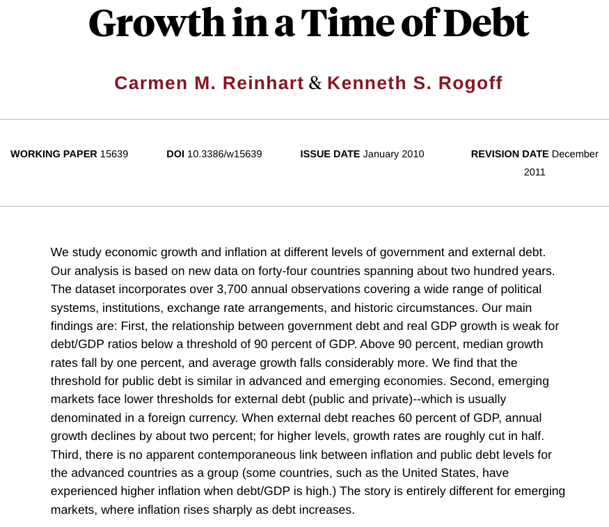

# The Global Austerity Excel Error

## Reading

::: {.nonincremental}
- Title: **The Reinhart-Rogoff Error - or how not to Excel at economics**
- Authors: Jonathan Borwein and David H. Bailey
- Journal: The Conversation
- Year: 2013
- <https://theconversation.com/the-reinhart-rogoff-error-or-how-not-to-excel-at-economics-13646>
:::

## Supporting Materials

Growth in a Time of Debt (C. Reinhart, K. Rogoff, 2010)

<https://www.nber.org/papers/w15639>

\

Does high public debt consistently stifle economic growth? 
A critique of Reinhart and Rogoff (T. Herndon, M. Ash, R. Pollin, 2014)

<https://peri.umass.edu/wp-content/uploads/joomla/images/WP322.pdf>

doi: <https://doi.org/10.1093/cje/bet075>

# The Story

## Overview {.nostretch}

{fig-align="center"}

In 2010, Harvard economists Carmen Reinhart and Kenneth Rogoff (R&R) published 
an influential paper claiming that 
[countries with public debt over 90% of GDP experience negative economic growth.]{.hilit}

## Overview 

:::: {.columns}
::: {.column width=60%}

:::

::: {.column width=40%}
This study was widely cited by politicians to justify harsh post-recession 
austerity cuts.
:::
::::

## Replication Attempt

Years later, graduate student Thomas Herndon tried to replicate the study 
of Reinhart & Rogoff for a class project and failed.

. . .

He found various problems:

- Selective exclusion of available data
- Coding errors
- Inappropriate weighting of summary statistics

. . .

\

His conclusion: Over 1946–2009, countries with public debt/GDP ratios above 
90% averaged 2.2% real annual GDP growth, not −0.1% as published

## One of the issues

Thomas Herndon discovered that R&R had accidentally missed five major countries 
when dragging down their `AVERAGE()` formula row.

Correcting this basic clerical error completely reversed their main conclusion.

## {background-image="images/excel-formulas-1.svg" background-size="contain"}

## {background-image="images/excel-formulas-2.svg" background-size="contain"}

## {background-image="images/excel-formulas-3.svg" background-size="contain"}

## {background-image="images/excel-formulas-4.svg" background-size="contain"}

## {background-image="images/excel-formulas-5.svg" background-size="contain"}

## {background-image="images/excel-formulas-6.svg" background-size="contain"}

# Participation Handout

