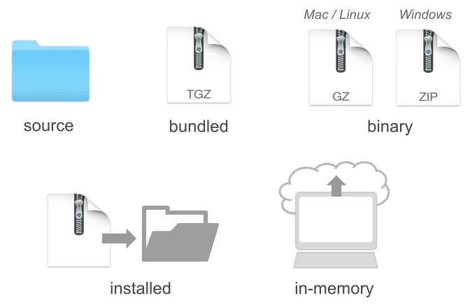
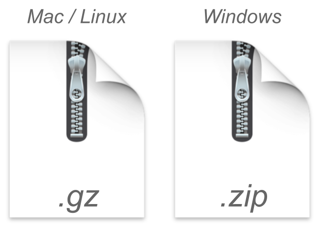
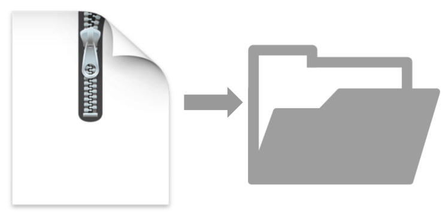
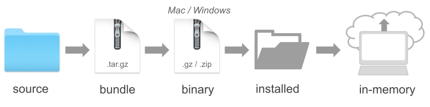

## About

In this slides I show you my opinionated recipe
to build packages.


# Recap: package `"average"`

## Example

```{r average_hidden}
#| echo: false
average <- function(x, na.rm = FALSE) {
  if (na.rm) {
    x <- x[!is.na(x)]
  }
  avg <- sum(x) / length(x)
  return(avg)
}
```

- Our package consists of one function: `average()`
- `average()` computes the average (i.e. mean) of a numeric vector

. . .

```{r}
#| echo: true
#| output-location: fragment
average(1:5)
```

. . .

```{r}
#| echo: true
#| output-location: fragment
average(c(1, 2, NA, 4, 5))
```

. . .

```{r}
#| echo: true
#| output-location: fragment
average(c(1, 2, NA, 4, 5), na.rm = TRUE)
```


# Package States

## Building An R Package

Now that we have most of the common elements of an R package,
let's talk about the package-building process.

I will show the way I like to create my packages. 

This means that you may find other useRs following different 
building strategies.


## Package States

The creation process of an R package can be done in several ways.
Depending on the _modus operandi_ that you choose to follow, it is
possible for a package to exist in five different states:

- Source
- Bundled
- Binary
- Installed
- In-memory


## Package States

{fig-align="center"}


## Source Package {.nostretch}

{fig-align="center" width="15%"}

- The starting point is always a [source package]{.bold-hilit}. 
- This is basically the directory containing the subdirectories and files
that form your package. 
- I like to think of this state as a package in a raw stage. 
- From a source package, you can transition to other states.


## Source Package {.nostretch}

{fig-align="center" width="12%"}

- The next immediate state (although not mandatory) is a 
[bundled package]{.bold-hilit}. 
- This involves wrapping the source package into a single
compressed file.
- The compressed file has the extension `.tar.gz`
    + A `.tar`, short for _Tape ARchive_ or _tarball_, is a standard
    format in the Unix/Linux environment.
    + A `.gz` file is simply the type of compression.


## Binary Package {.nostretch}

{fig-align="center" width="20%"}

- A [package in binary form]{.bold-hilit} is another type of state for a package.
- This is another type of compressed file that is platform specific.
- This depends on the operating system you are working with:
    + Mac/Linux 
    + Windows


## Installed Package {.nostretch}

{fig-align="center" width="20%"}

- An [installed package]{.bold-hilit} is a decompressed binary file that has
been unwrapped into an actual package library.
- Typically, it will be located in the directory where other package
libraries are stored.


## In-memory Package {.nostretch}

{fig-align="center" width="20%"}

- Lastly, in order to use an installed package you need to load it into
memory. 
- This is done with the `library()` function.


## {.nostretch}

During the development of a package, you always start at the
source level, and eventually make your way to an installed version.

{fig-align="center" width="80%"}

In theory, the building process would consist of the following flow:

[source -> bundle -> binary -> installed —> in-memory]{.bold-hilit}

In practice, however, you can take some detours and shortcuts
from source to installed.


# Packaging Flow

## Packaging Flow

A typical packaging workflow involves the following steps:

- Create Documentation
- Check Documentation
- Run Tests
- Build Bundle
- Install Package
- Check Package

## Packaging Flow

A typical packaging workflow involves the following steps:

- Create Documentation: &nbsp;&nbsp; `devtools::document()`
- Check Documentation: &nbsp;&nbsp; `devtools::check_man()`
- Run Tests: &nbsp;&nbsp; `devtools::test()`
- Build Bundle: &nbsp;&nbsp; `devtools::build()`
- Install Package: &nbsp;&nbsp; `devtools::install()`
- Check Package: &nbsp;&nbsp; `devtools::check()`


## Create Documentation

When you change the roxygen comments of your 
functions, you will need to (re)generate the corresponding manual documentation. 

\

This can be done with the function `devtools::document()` which 
generates the so-called `.Rd` (R documentation) files, located in the `man/` 
directory.


## Check Documentation

An optional---but strongly recommended---step after new 
documentation has been generated, is to check that it is correct. 

\

This step becomes mandatory if you plan to share your package via CRAN. 

\

To check that the `.Rd` files are okay, use the function  
`devtools::check_man()` which inspects that the content and syntax of
the `.Rd` files are correct. 


## Run Tests

If your package contains unit-tests (strongly suggested),
included in the directory `tests/`, you can use the function 
`devtools::test()` to run such tests.


## Build Bundle

If you just simply want to convert a package source into a 
single bundled file, you use the function `devtools::build()` 

\

This function will create, by default, the `.tar.gz` file that in turn can be 
installed on any platform.

\

`build()` does not generate or check any documentation. It also does not run 
any tests.


## Install

To install the package you can use `devtools::install()` 

\

This function can install a source, bundle or a binary package. 

\

After the installation is done, you should be able to load the package with 
`library()` in order to use its functions, and inspect its manual documentation.


## Check

Optionally, you can carry out an integral check of the package
with the function `devtools::check()`

\

This checking process is a comprehensive one, and it will verify pretty much 
every single detail.

\

This step also becomes mandatory if you plan to share your package via CRAN. 


## Optional devtools file

Unless you are constantly creating packages, you will very likely forget what 
functions to use for a specific purpose. One small hack that I tend to use is 
to include an auxiliary `.R` file in the source package, which I typically name 
as `devtools-flow.R` (or something like that) with the following content:

```{.r filename="devtools-flow.R" code-line-numbers="false"}
# Devtools workflow
devtools::load_all()   # load your functions (then try them out)
devtools::document()   # generate documentation
devtools::check_man()  # check documentation
devtools::test()       # run tests (if any)
devtools::build()      # build bundle
devtools::install()    # install package
devtools::check()      # comprehensive check (optional)
```


## Optional devtools file

- You can think of `devtools-flow.R` as a cheat-sheet. 
- This file should be included in `.Rbuildignore`.
- Add a new line with the name of the file to `.Rbuildignore`, and remember to 
anchor it with `^` and `$`. 
- Here's what your `.Rbuildignore` file may look like:

. . .

```{.markdown filename=".Rbuildignore" code-line-numbers="false"}
^average\.Rproj$
^\.Rproj\.user$
^\.positai$
^\.claude$
^data-raw$
^devtools-flow.R$
```
