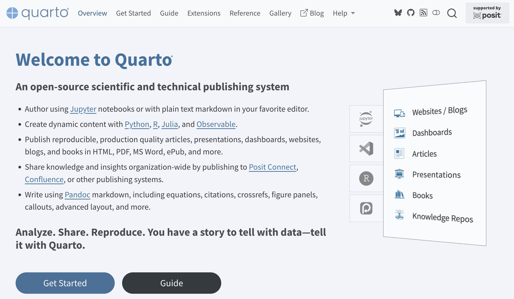
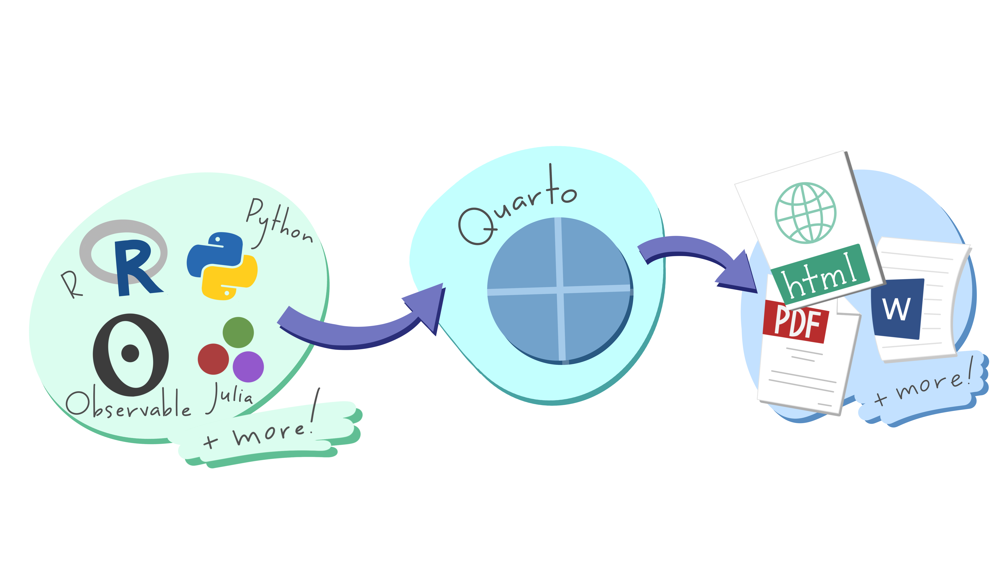
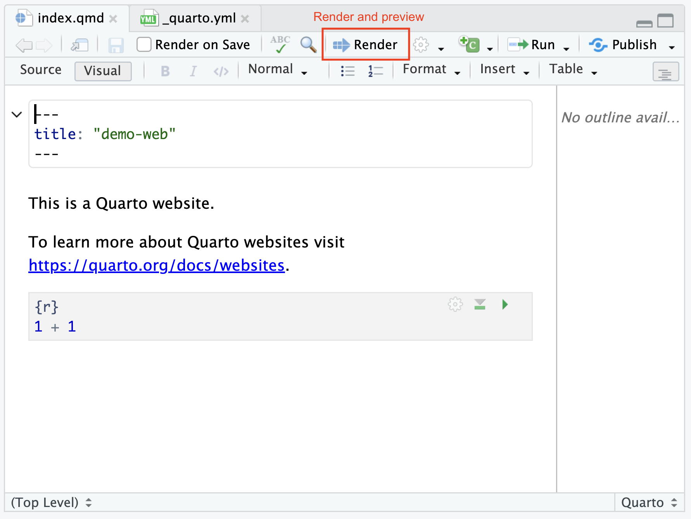

# Intro

## Quarto

Open-source scientific and technical publishing system

<https://quarto.org/>

{fig-align="center"}


## Quarto Publications

::: {.nonincremental}
- Articles
- Presentations
- Dashboards
- Websites
- Blogs
- Books
- Knowledge Repos
:::


## About Quarto

- Quarto is developed by Posit, PBC (Public Benefit Corporation)

- It was launched in 2022.

- Posit's team rebuilt the concept of R Markdown from the ground up as a
language-agnostic, standalone Command Line Interface (CLI) tool. 

- It is named after a classic publishing term referring to a book or 
pamphlet produced from full sheets of paper folded twice to form four leaves (eight pages).


## About Quarto

:::: {columns}
::: {.column}
Designed to work seamlessly anywhere: 

- Visual Studio Code
- JupyterLab
- Positron
- RStudio
- Neovim
- Standard command terminals
:::


::: {.column .fragment}
Write content once in plain text Markdown (`.qmd`, `.ipynb`, `.Rmd`) 
and publish it into any target format: 

- HTML pages
- PDF documents
- Microsoft Word files
- PowerPoint presentations
- Reveal.js slides
- Interactive books
- Entire websites
:::
::::


## Quarto core idea

{fig-align="center"}

- Author using Markdown (`.qmd`, `.Rmd`) files or Jupyter notebooks.

- Create dynamic content with Python, R, Julia, Observable JS, and more.

- Write using Pandoc markdown, including equations, citations, 
crossrefs, figure panels, callouts, advanced layout, and more.


# Quarto Websites

## Quarto Websites

<https://quarto.org/docs/websites/>

- You can create a Website using:
    + the Terminal
    + RStudio
    + VS Code
    + Positron
    + JupyterLab


# Quarto Website from CLI

## Create a Quarto Website (via the Terminal)

The `quarto` command to create a website is:

. . .

```{.markdown code-line-numbers="false"}
quarto create project website <website-name>
```

. . .

\

```{.markdown code-line-numbers="false"}
# example
quarto create project website demo-website
```

. . .

This command will create a `demo-website/` folder with the following files:

```
demo-website/
├── _quarto.yml    # The "brain" and main config file of the site
├── index.qmd      # The homepage (rendered to index.html)
├── about.qmd      # An about page (rendered to about.html)
├── styles.css     # Optional custom CSS overrides
```


## `_quarto.yml` config file {.smaller}

\

:::: {.columns}
::: {.column width="45%"}
```{.markdown filename="_config.yml" code-line-numbers="false"}
project:
  type: website

website:
  title: "My Awesome Site"
  navbar:
    left:
      - href: index.qmd
        text: Home
      - href: about.qmd
        text: About

format:
  html:
    theme: cosmo
    css: styles.css
```
:::

::: {.column width="5%"}
:::

::: {.column width="50%"}
- `_quarto.yml` is the most important configuration file. 
- It dictates the project type (`type: website`), 
- navigation bars, 
- site title, footer, 
- global themes, 
- and shared YAML options for all pages.
:::
::::


## Things to keep in mind

- A website should only have one `_quarto.yml` file (root level)

- Do not change the name of `index.qmd` (otherwise you risk breaking your deployment.)


## Previewing a website

The `quarto` command to preview a website is:

. . .

```{.markdown code-line-numbers="false"}
quarto preview
```

. . .

- `quarto preview` spins up a live-reload local development server
- the `_site/` folder is generated (don't edit its contents)
- while previewing a website, every time you save a `.qmd` file,
it re-renders the page in real time


## Rendering a website

The `quarto` command to render a website is:

. . .

```{.markdown code-line-numbers="false"}
quarto render
```

- `quarto render` compiles your source files into final outputs
    + it loops through all connected files, 
    + builds the navigation,
    + outputs the complete website in `_site/`


## Rendering a website (cont'd)

If you delete a `.qmd` file or rename it, the old HTML file inside `_site/` 
might stick around until you perform a clean render or manually clear the 
output directory.

. . .

You can run:

```{.markdown code-line-numbers="false"}
# force a full clean re-render (ignoring cached results)
quarto render --no-cache
```


# Quarto Website via RStudio

## Quarto Website (via RStudio)

Another way to create a Quarto website is using RStudio.

\

Because RStudio is part of this semester's STAT 159 datahub we want to 
show you how to create a Quarto website with this tool.


## Create a Quarto Website (via RStudio)

1) Go to the [File]{.bold-hilit} tab in the top menu bar
2) Click on [New Project]{.bold-hilit}
3) When prompted with the **Create Project** choose [New Directory]{.bold-hilit}
4) When prompted with the **Project Type** choose [Quarto Website]{.bold-hilit}
5) Then select a directory and a name for your project
6) Click on [Create Project]{.bold-hilit}


## {background-image="images/quarto-website-rstudio.png" background-size="contain"}

## Create a Quarto Website (via RStudio)

The default file structure of the quarto website is:

```
demo-web/
├── _quarto.yml      # The "brain" and main config file of the site
├── index.qmd        # The homepage (rendered to index.html)
├── about.qmd        # An about page (rendered to about.html)
├── styles.css       # Optional custom CSS overrides
├── demo-web.Rproj   # RStudio project
```

. . .

::: {.poll}
The main difference between creating a website via RStudio -vs- the Terminal
is that in RStudio you have the additional `.Rproj` file
:::


## Quarto Website (via RStudio)

To render and preview the website, you click on the `Render` button

{fig-align="center"}


# Website Workflow

## Workflow

- Add additional pages to your website (e.g., by adding `.qmd` files)

- Edit config file `_quarto.yml` to include added pages

- Website Preview: `quarto preview`

- Website Render: `quarto render`
    + Renders website into the `_site/` directory by default

- Or click `render` button in RStudio

- Rinse and repeat


## Additional Elements

- Website Navigation <br>
<https://quarto.org/docs/websites/website-navigation.html>

- Website Theme <br>
<https://quarto.org/docs/output-formats/html-themes.html>

- Website Drafts <br>
<https://quarto.org/docs/websites/website-drafts.html>

- Headers and Footers <br>
<https://quarto.org/docs/websites/website-drafts.html>


# Websites for Data Projects

## Architecture for Data Projects

\

When structuring a data project as a Quarto site, you typically 
choose between two main layouts: 

:::: {.columns}
::: {.column}
[A) Modular Analysis Pipeline]{.bold-hilit}

Break a large analysis down into logical sequence steps. 
Each step becomes a separate page, accessible via the top navigation bar 
or a sidebar
:::

::: {.column}
[B) The Listing / Portfolio Site]{.bold-hilit}

Use Quarto's built-in [Listing Pages]{.hilit} (the engine used for blogs) 
to host multiple data projects or sub-analyses on one site
:::
::::

\

BTW: We'll cover approach A


## Example

Assume your project has the following pipeline:

:::: {.columns}
::: {.column width="50%"}
1) Data Preparation: 
    + `01_data_prep.qmd`
    + `data_dictionary.qmd`

\

2) Exploratory Analysis: 
    + `02_exploration.qmd`
:::

::: {.column width="50%"}
3) Modeling: 
    + `03_modeling.qmd`

\

4) Conclusions:
    + `04_conclusions.qmd`
:::
::::


## Deciding Website Navigation {.smaller}

:::: {.columns}
::: {.column}
Navigation bar (i.e. menu bar, left-aligned tabs)

```{.markdown filename="_config.yml" code-line-numbers="false"}
# left-aligned tabs in navbar
website:
  title: "My Project"
  navbar:
    left:
      - ...
```

::: {.fragment}
Navigation bar (i.e. menu bar, right-aligned tabs)

```{.markdown filename="_config.yml" code-line-numbers="false"}
# right-aligned tabs in navbar
website:
  title: "My Project"
  navbar:
    right:
      - ...
```
:::
:::


::: {.column .fragment}
Sidebar

```{.markdown filename="_config.yml" code-line-numbers="false"}
# sidebar (on right-hand side)
website:
  title: "My Project"
  sidebar:
    - ...
```

::: {.fragment}
Hybrid: Navbar and Sidebar

```{.markdown filename="_config.yml" code-line-numbers="false"}
# sidebar and navbar
website:
  title: "My Project"
  navbar:
    left:
      - ...
  sidebar:
    - ...
```
:::
:::
::::


## `_quarto.yml` Navigation bar {.smaller}

\

:::: {.columns}
::: {.column width="45%"}
```{.markdown filename="_config.yml" code-line-numbers="false"}
project:
  type: website

website:
  # content displayed on right-column --->
  # for sake of clarity               --->

execute:
  echo: true       # Show code by default
  warning: false   # Hide warning messahes
  freeze: auto     # freeze execution

format:
  html:
    theme: cosmo
    toc: true
    toc-depth: 3
    css: styles.css
```
:::

::: {.column width="5%"}
:::

::: {.column width="50%"}
```{.markdown filename="_config.yml" code-line-numbers="false"}
website:
  title: "My Project"
  navbar:
    search: true
    contents:
      - text: "Overview"
        href: index.qmd
      - section: "Analysis"
        contents:
          - href: 01_data_prep.qmd
          - href: 02_exploration.qmd
          - href: 03_modeling.qmd
          - href: 04_conclusions.qmd
      - text: "Codebook"
        href: data_dictionary.qmd
```
:::
::::


## `_quarto.yml` Sidebar bar {.smaller}

\

:::: {.columns}
::: {.column width="45%"}
```{.markdown filename="_config.yml" code-line-numbers="false"}
project:
  type: website

website:
  # content displayed on right-column --->
  # for sake of clarity               --->

execute:
  echo: true       # Show code by default
  warning: false   # Hide warning messahes
  freeze: auto     # freeze execution

format:
  html:
    theme: cosmo
    toc: true
    toc-depth: 3
    css: styles.css
```
:::

::: {.column width="5%"}
:::

::: {.column width="50%"}
```{.markdown filename="_config.yml" code-line-numbers="false"}
website:
  title: "My Project"
  sidebar:
    style: "docked"
    search: true
    contents:
      - text: "Overview"
        href: index.qmd
      - section: "Analysis"
        contents:
          - href: 01_data_prep.qmd
          - href: 02_exploration.qmd
          - href: 03_modeling.qmd
          - href: 04_conclusions.qmd
      - text: "Codebook"
        href: data_dictionary.qmd
```
:::
::::


## `_quarto.yml` Hybrid (Navbar & Sidebar) {.smaller}

\

:::: {.columns}
::: {.column width="45%"}
```{.markdown filename="_config.yml" code-line-numbers="false"}
project:
  type: website

website:
  # content displayed on right-column --->
  # for sake of clarity               --->

execute:
  echo: true       # Show code by default
  warning: false   # Hide warning messahes
  freeze: auto     # freeze execution

format:
  html:
    theme: cosmo
    toc: true
    toc-depth: 3
    css: styles.css
```
:::

::: {.column width="5%"}
:::

::: {.column width="50%"}
```{.markdown filename="_config.yml" code-line-numbers="false"}
website:
  title: "My Project"
  navbar:
    left: 
      - text: "Overview"
        href: index.qmd
      - text: "Analysis
        href: analysis.qmd
      - text: "Codebook"
        href: data_dictionary.qmd
  sidebar:
    - title: "Analysis"
      style: "docked"
      contents:
        - href: 01_data_prep.qmd
        - href: 02_exploration.qmd
        - href: 03_modeling.qmd
        - href: 04_conclusions.qmd
```
:::
::::


## Freeze execution (`execute: freeze: auto`)

Executing complex models or massive data pipelines every single time 
you render a site will severely slow you down.

- Setting `freeze: auto` tells Quarto to save computational results 
in a `_freeze/` folder.

- Code chunks will only re-run when the source `.qmd` file actually changes.

- Commit the `_freeze/` folder to Git! This allows Continuous Integration 
platforms (like GitHub Actions) to publish your site without needing 
access to your raw databases or computing environment.


