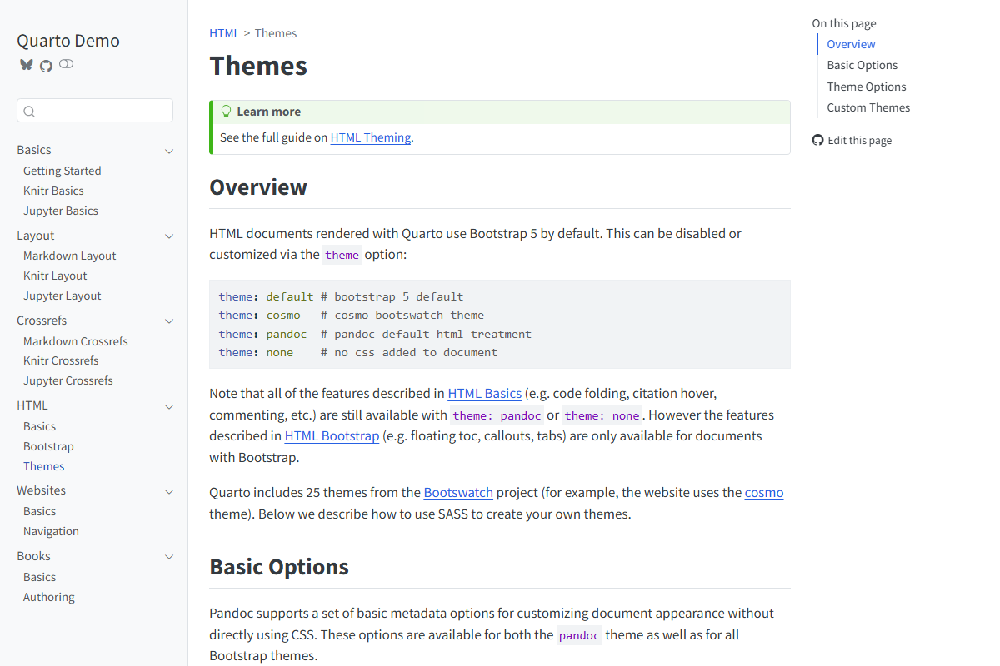
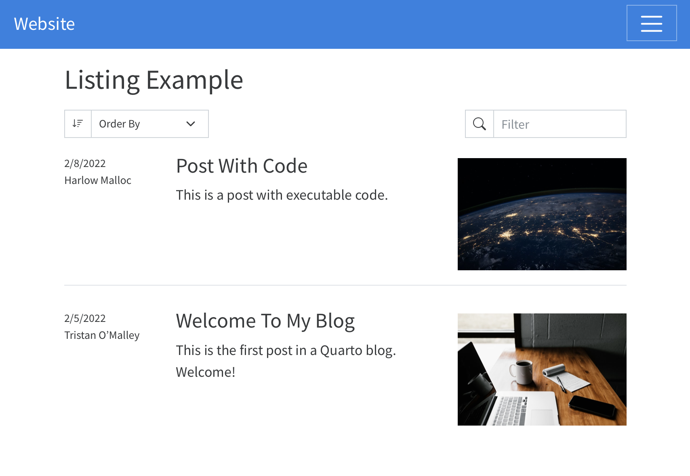

# Websites for Data Projects

## Architecture for Data Projects

When structuring a data project as a Quarto site, you typically 
choose between two main layouts: 

. . .

:::: {.columns}
::: {.column}
[A) Modular Analysis Pipeline]{.bold-hilit}

{fig-align="center"}
:::

::: {.column .fragment}
[B) The Listing / Portfolio Site]{.bold-hilit}

{fig-align="center"}
:::
::::


## Architecture for Data Projects

When structuring a data project as a Quarto site, you typically 
choose between two main layouts: 

. . .

:::: {.columns}
::: {.column}
[A) Modular Analysis Pipeline]{.bold-hilit}

Break a large analysis down into logical sequence steps.

Each step becomes a separate page, accessible via the top navigation bar 
or a sidebar
:::

::: {.column .fragment}
[B) The Listing / Portfolio Site]{.bold-hilit}

Use Quarto's built-in [Listing Pages]{.hilit} (the engine used for blogs) 

Host multiple data projects or sub-analyses in theit own blog post.
:::
::::

\

BTW: We'll cover approach A


## Example

Assume your project has the following pipeline:

:::: {.columns}
::: {.column width="50%"}
1) Data Preparation: 
    + `01_data_prep.qmd`
    + `data_dictionary.qmd`

2) Exploratory Analysis: 
    + `02_exploration.qmd`
:::

::: {.column width="50%"}
3) Modeling: 
    + `03_modeling.qmd`

4) Conclusions:
    + `04_conclusions.qmd`
:::
::::

::: {.poll .fragment}
How to organize and present these in a website?
:::


## Deciding Website Navigation {.smaller}

:::: {.columns}
::: {.column}
Navigation bar (i.e. menu bar, [left-aligned]{.hilit} tabs)

```{.markdown filename="_config.yml" code-line-numbers="false"}
# left-aligned tabs in navbar
website:
  title: "My Project"
  navbar:
    left:
      - ...
```

::: {.fragment}
Navigation bar (i.e. menu bar, [right-aligned]{.mdlit} tabs)

```{.markdown filename="_config.yml" code-line-numbers="false"}
# right-aligned tabs in navbar
website:
  title: "My Project"
  navbar:
    right:
      - ...
```
:::
:::


::: {.column .fragment}
Sidebar

```{.markdown filename="_config.yml" code-line-numbers="false"}
# sidebar (on right-hand side)
website:
  title: "My Project"
  sidebar:
    - ...
```

::: {.fragment}
Hybrid: Navbar and Sidebar

```{.markdown filename="_config.yml" code-line-numbers="false"}
# sidebar and navbar
website:
  title: "My Project"
  navbar:
    left:
      - ...
  sidebar:
    - ...
```
:::
:::
::::


## `_quarto.yml` Navigation bar {.smaller}

\

:::: {.columns}
::: {.column width="45%"}
```{.markdown filename="_config.yml" code-line-numbers="false"}
project:
  type: website

website:
  # content displayed on right-column --->
  # for sake of clarity               --->

execute:
  echo: true       # Show code by default
  warning: false   # Hide warning messahes
  freeze: auto     # freeze execution

format:
  html:
    theme: cosmo
    toc: true
    toc-depth: 3
    css: styles.css
```
:::

::: {.column width="5%"}
:::

::: {.column width="50%"}
```{.markdown filename="_config.yml" code-line-numbers="false"}
website:
  title: "My Project"
  navbar:
    search: true
    contents:
      - text: "Overview"
        href: index.qmd
      - section: "Analysis"
        contents:
          - href: 01_data_prep.qmd
          - href: 02_exploration.qmd
          - href: 03_modeling.qmd
          - href: 04_conclusions.qmd
      - text: "Codebook"
        href: data_dictionary.qmd
```
:::
::::


## `_quarto.yml` Sidebar bar {.smaller}

\

:::: {.columns}
::: {.column width="45%"}
```{.markdown filename="_config.yml" code-line-numbers="false"}
project:
  type: website

website:
  # content displayed on right-column --->
  # for sake of clarity               --->

execute:
  echo: true       # Show code by default
  warning: false   # Hide warning messahes
  freeze: auto     # freeze execution

format:
  html:
    theme: cosmo
    toc: true
    toc-depth: 3
    css: styles.css
```
:::

::: {.column width="5%"}
:::

::: {.column width="50%"}
```{.markdown filename="_config.yml" code-line-numbers="false"}
website:
  title: "My Project"
  sidebar:
    style: "docked"
    search: true
    contents:
      - text: "Overview"
        href: index.qmd
      - section: "Analysis"
        contents:
          - href: 01_data_prep.qmd
          - href: 02_exploration.qmd
          - href: 03_modeling.qmd
          - href: 04_conclusions.qmd
      - text: "Codebook"
        href: data_dictionary.qmd
```
:::
::::


## `_quarto.yml` Hybrid (Navbar & Sidebar) {.smaller}

\

:::: {.columns}
::: {.column width="45%"}
```{.markdown filename="_config.yml" code-line-numbers="false"}
project:
  type: website

website:
  # content displayed on right-column --->
  # for sake of clarity               --->

execute:
  echo: true       # Show code by default
  warning: false   # Hide warning messahes
  freeze: auto     # freeze execution

format:
  html:
    theme: cosmo
    toc: true
    toc-depth: 3
    css: styles.css
```
:::

::: {.column width="5%"}
:::

::: {.column width="50%"}
```{.markdown filename="_config.yml" code-line-numbers="false"}
website:
  title: "My Project"
  navbar:
    left: 
      - text: "Overview"
        href: index.qmd
      - text: "Analysis
        href: analysis.qmd
      - text: "Codebook"
        href: data_dictionary.qmd
  sidebar:
    - title: "Analysis"
      style: "docked"
      contents:
        - href: 01_data_prep.qmd
        - href: 02_exploration.qmd
        - href: 03_modeling.qmd
        - href: 04_conclusions.qmd
```
:::
::::


# Integrating Data Pipelines

## Data Pipelines

It's not uncommon to work on a project that involves several data files,
cleaning those files, deriving subsets from them, and then performing
computations on them.

Likewise, it's not uncommon to run simulations or modeling steps
that may take some time and/or depend on external computational resources 
(e.g. remote servers, computer clusters, etc).

You don't want to unnecessarily be running those computations everytime you 
render/preview your website.


## Freeze execution (`execute: freeze: auto`)

Executing complex models or massive data pipelines every single time 
you render a site will severely slow you down.

```{.markdown filename="_config.yml" code-line-numbers="false"}
project:
  type: website

website:
  # content hidden for clarity

execute:
  echo: true       # Show code by default
  warning: false   # Hide warning messahes
  freeze: auto     # freeze execution

format:
  # content hidden for clarity
```


## Freeze execution (`execute: freeze: auto`)

Executing complex models or massive data pipelines every single time 
you render a site will severely slow you down.

- Setting `freeze: auto` tells Quarto to save computational results 
in a `_freeze/` folder.

- Code chunks will only re-run when the source `.qmd` file actually changes.

- Commit the `_freeze/` folder to Git! This allows Continuous Integration 
platforms (like GitHub Actions) to publish your site without needing 
access to your raw databases or computing environment.


## Script files

In addition to freezing execution, you can also include script files 
(e.g., `.R`, `.py` files) that take care of certain computational 
steps without being part of the `.qmd ` files of your website.

In these situations you can manage everything with a `Makefile`,
having separate rules for elements other than the website, and 
a special rule just for rendering the website.


## Example {.smaller}

```
demo-web/
├── README.md           # Main readme file
├── _quarto.yml         # The "brain" and main config file of the site
├── index.qmd           # The homepage (rendered to index.html)
├── 01_data_prep.qmd
├── 02_exploration.qmd
├── 03_modeling.qmd
├── 04_conclusions.qmd 
├── styles.css          # Optional custom CSS overrides
├── data/               # data folder (raw, clean data sets, codebook)
├── scripts/            # folder for R/Py scripts
├── outputs/            # folder for derived outputs (might be used in qmd files)
```

\

Other files that could be necessary/worth including:

```
├── LICENSE             # License(s) for your project (code & media)
├── Makefile            # Rules for multiple tasks
├── environment.yml     # Conda environment
├── demo-web.Rproj      # (optional if using RStudio)
```
