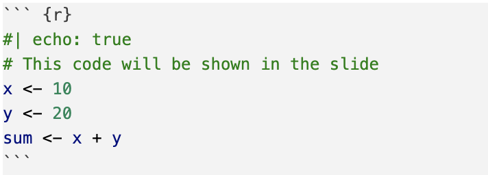
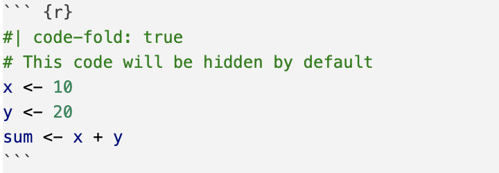
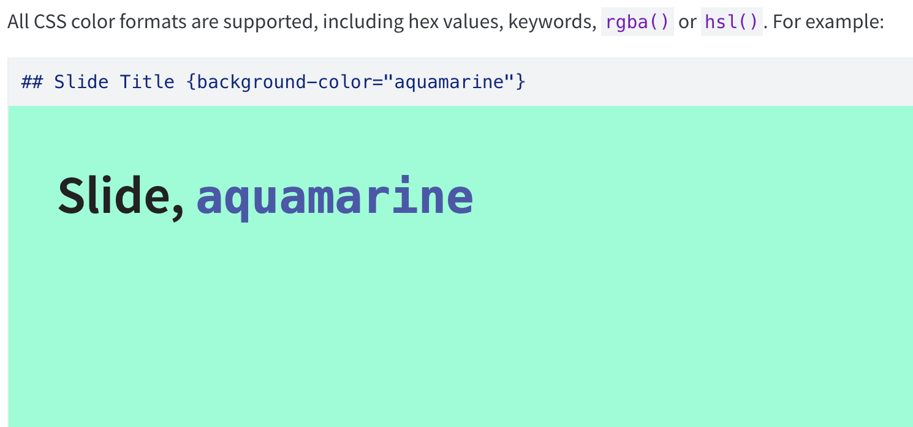
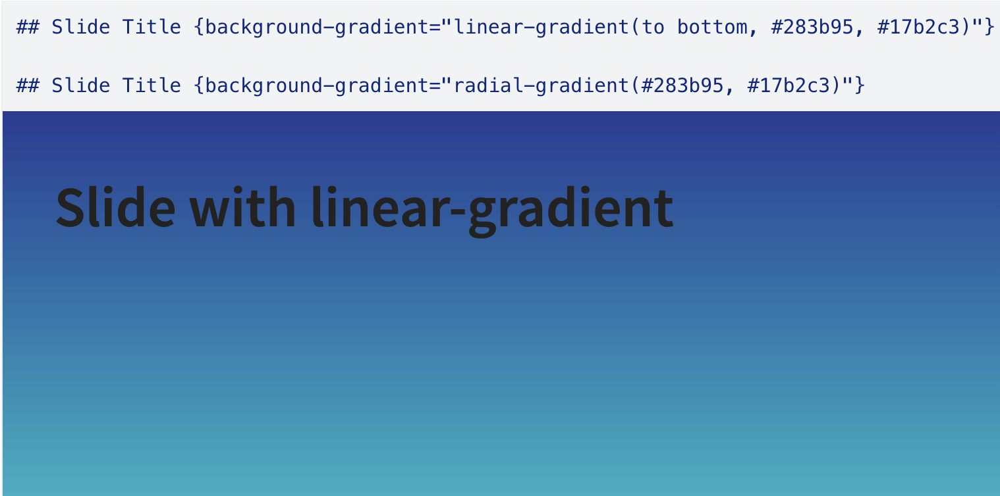

# Quarto Revealjs Slides

## About

These slides will introduce creating **RevealJS** slides with 
**Quarto Markdown**. 

## What can we do with slides?

As with any other `.qmd` documents:

-   Text
-   Code chunks
-   Figures

. . .

BTW: The slides in STAT 159 are made with Quarto & Revealjs


## Also:

-   In-line code
-   Code folding
-   Slide backgrounds and gradients
-   Bulleted lists and incremental bullets

\

::: {.fragment}
### And much more!

<https://quarto.org/docs/presentations/revealjs/>
:::


## YAML Heading of a Slide Document

``` {.markdown filename="demo-slides.qmd" code-line-numbers="false"}
---
title: "Demo Slides"
subtitle: "First Contact with Quarto Slides"
author: "Your Name"
format: revealjs
embed-resources: true
---
```

\

We recommend setting `embed-resources` to `true` to make sure all 
resources are included in the rendered HTML document.


# Basic Elements

## Formatting Slides

::: {.nonincremental}
- Quarto allows you to create slides using markdown syntax
- Use `#` or `##` to separate slides
- One `#` denotes a section, for which a title slide will be created.
- Two `#`s denote a slide title, for which a regular slide will be created.
- Three or more `#`s creates subheaders as usual.
:::


## Headers

``` {.markdown code-line-numbers="false"}
# Slide 1 - Section

Content of the slide goes here.

## Slide 2 - Subsection

More content here.

### Slide 2 - Sub-subheading
```


## Lists

Lists are created as with Markdown.

::: {.fragment}
### Bullets

- Value 1 
- Value 2 
:::

::: {.fragment}
### Numbered

1. Value 1 
2. Value 2
:::


## Incremental Bullets

We can use `:::` to create incremental bullets.

``` {.markdown code-line-numbers="false"}
::: {.incremental}
-   First bullet
-   Second bullet
-   Third bullet
:::
```

. . .

When rendered, they will be displayed as follows:

-   First bullet
-   Second bullet
-   Third bullet


## Tables

Tables are created as with Markdown.

| x | y | z |
|---|---|---|
| 0 | 0 | 0 | 
| 1 | 1 | 0 |

. . .

\

```{.markdown code-line-numbers="false"}
| x | y | z |
|---|---|---|
| 0 | 0 | 0 | 
| 1 | 1 | 0 |
```


## Familiarities: Font Face

You can control the font face as with R Markdown.

- **Bold**.
- _Italicized_.
- **_Bold and italicized!_**
- ``monospaced``


## Links and Images

Links and images can be included as with R Markdown. 

Have you heard of [wormholes](https://en.wikipedia.org/wiki/Wormhole)?


# Figures

## Figure Basics

```{.markdown code-line-numbers="false"}

```

. . .

\


. . .

\

<https://quarto.org/docs/authoring/figures.html>


## Figure Alignment

```{.markdown code-line-numbers="false"}
{fig-align="center"}
```

. . .

\

{fig-align="center"}

\

. . .

```{.markdown code-line-numbers="false"}
{fig-align="right"}
```

. . .

\

{fig-align="right"}


## Figure Sizing {.nostretch}

```{.markdown code-line-numbers="false"}
{height=30%}
```

. . .

\

{width=30%}


## Figure Layout

```{.markdown code-line-numbers="false"}
::: {#fig-logos layout-ncol=2}
{#fig-logo1}

{#fig-logo2}

R logos
:::
```

::: {#fig-logos layout-ncol=2}
{#fig-logo1}

{#fig-logo2}

R logos
:::


## Columns

:::: {.columns}
::: {.column}

```{.markdown code-line-numbers="false"}
:::: {.columns}
::: {.column}
Column 1
:::

::: {.column}
Column 2
:::
::::
```

:::

::: {.column}
```{.markdown code-line-numbers="false"}
:::: {.columns}
::: {.column width="40%"}
Column 1
:::

::: {.column width="60%"}
Column 2
:::
::::
```
:::
::::


# Adding Code

## Adding code

Code is added the same way as in regular `qmd` files, using code chunks.

\

``` r
# Example code chunk
x <- 10
y <- 20
sum <- x + y
```

\

But we can also do a lot more with code chunks in slides, such as...


## Echo True

By default, code chunks in slides are hidden. You can change this
behavior by using the `echo` option.



``` {r}
#| echo: true
# This code will be shown in the slide
x <- 10
y <- 20
sum <- x + y
```


## In-line code

You can also include in-line code using backticks:


## In-line code

This code outputs: \
\
The sum of `x` and `y` is `x + y`. \
The sum of `x` and `y` is `r x + y`.
\
\
**Useful for:** \
- showing code without running it \
- showing formulas or calculations without needing a full code chunk


## Code Folding

You can fold code chunks to hide them by default and allow the audience 
to expand them if they want to see the code.

In YAML header:

``` {.markdown code-line-numbers="false"}
---
title: "Demo Slides"
subtitle: "First Contact with Quarto Slides"
author: "Your Name"
format: 
  revealjs:
    code-fold: true
    embed-resources: true
---
```


## Code Folding

In each code block that you want to fold:

{width=50px}

``` {r}
#| code-fold: true
# This code will be hidden by default
x <- 10
y <- 20
sum <- x + y
```


# Backgrounds

## Backgrounds

Another formatting option is to add backgrounds to your slides. 
You can use either a single color or a gradient.


## Background: Single Color




## Background: Gradient 




# Transitions

## Transitions by Slide

You can specify the transition and/or transition-speed for an individual slide:

``` {.markdown code-line-numbers="false"}
## Slide Title {transition="fade" transition-speed="fast"}
```

\

You can also specify separate in and out transitions, for example:

``` {.markdown code-line-numbers="false"}
## Slide Title {transition="fade-in slide-out"}
```


# Fragments

## Fragments: Transitions

**_Fragments_** give Quarto Markdown an expressive power _not_ found
in R Markdown: **transitions**.

. . . 

The simplest way to do this is by separating sections between 3 dots
(with a space between each). See below:

```{text}
#| echo: true
**_Fragments_** give Quarto Markdown an expressive power _not_ found
in R Markdown: **transitions**.

. . . 

The simplest way to do this is by separating sections between 3 dots
(with a space between each). See below:
```

## Fragments: Syntax

For more advanced transitions, we introduce a new syntax:

```{text}
#| echo: true
::: {.fragment}
Your text here.
::: 
```

. . .

- Surround your text with three colons (``:::``) on each end.
- As with code chunks, we will specify options in curly brackets ``{
... }``. Start with ``.fragment`` to create a fragment.
- You can think of this as a _format chunk_ by noting the similarity in syntax
to code chunks, which instead of colons use backticks.

## Fragments: Classes 

You provide a **fragment class** in the curly brackets to specify a transition.
Here are some examples, showing you can...

::: {.fragment .highlight-red}
... highlight text.
:::

::: {.fragment .shrink}
_... shrink and grow text._
:::

::: {.fragment .fade-out}
_... fade out text._
:::

::: {.fragment .fade-right}
**... fade in text.**
:::

::: {.fragment .grow}
See [here](https://quarto.org/docs/presentations/revealjs/advanced.html#fragment-classes) for a 
list of all available classes. 

<https://quarto.org/docs/presentations/revealjs/advanced.html>
:::

## Fragments: Classes {.smaller}

Here's the code for the shown fragments. 

```{text}
#| echo: true
::: {.fragment .highlight-red}
... highlight text.
:::

::: {.fragment .shrink}
_... shrink and grow text._
:::

::: {.fragment .fade-out}
_... fade out text._
:::

::: {.fragment .fade-right}
**... fade in text.**
:::
```

- You need to add a dot (``.``) before the class name. 
- Unlike code chunks, which separate options with commas, here 
we separate options with _spaces_. 

## Fragments: Multiple Classes

You can specify multiple classes to combine transitions. 

::: {.fragment .grow .highlight-blue}
**Pay attention to this!**
:::

```{text}
#| echo: true
::: {.fragment .grow .highlight-blue}
**Pay attention to this!**
:::
```

## Fragments: Nesting 

You can nest fragments[^2] to provide multiple transitions for one chunk of text. 
They will be executed in order (from the outer to inner fragments).

::: {.fragment .fade-up}
::: {.fragment .grow .highlight-red}
::: {.fragment .shrink .highlight-blue}
::: {.fragment .fade-out}
I'm feeling animated today!
:::
:::
:::
:::

```{text}
#| echo: true
::: {.fragment .fade-up}
::: {.fragment .grow .highlight-red}
::: {.fragment .shrink .highlight-blue}
::: {.fragment .fade-out}
I'm feeling animated today!
:::
:::
:::
:::
```

## Styling with CSS 

You can make changes beyond the provided fragment classes. For example, 
if you're familiar with CSS, you can control the style of the text directly:

::: {.fragment .fade-right style="color: #85271E; text-shadow: 2px 2px 5px #7D3F39; font-weight: bold; letter-spacing: 5px; text-align: center; font-size: 2.5em"}
Here's some mutilated text! :)
:::

. . .

```{text}
#| echo: true
::: {.fragment .fade-right style="color: #85271E; text-shadow: 2px 2px 5px #7D3F39; font-weight: bold; letter-spacing: 5px; text-align: center; font-size: 2.5em"}
Here's some mutilated text! :)
:::
```

[^2]: The syntax is unfortunately verbose.


